# Incidents Agent

Incidents Agent investigates service incidents from metrics, logs, traces, and
other telemetry. It ranks possible root causes and cites the evidence behind its
diagnosis. See the [design](DESIGN.md) and [implementation plan](planning/).



## Quickstart

Install [uv](https://docs.astral.sh/uv/) and run:

```sh
uv python install
uv sync --locked --group benchmark
make app
```

Open the localhost URL printed by Streamlit. Use the app’s free demo mode to
try an investigation without a provider key. For a live run, copy
`.env.example` to `.env` and configure the key for your model of choice from
`config/models.yaml`. The default is the OpenAI alias `gpt-small`.

To export the RCAEval benchmark and rehearse the evaluation without spending:

```sh
make export
make split
make baselines
make eval EVAL_ARGS='--cases tuning --limit 3 --dry-run'
```

The first export downloads the benchmark. To reuse an existing extracted
RE2-OB dataset, replace `make export` with:

```sh
uv run --locked --group benchmark rcaeval-agent export --dataset re2-ob \
  --out agent_tasks --data-root /absolute/path/to/RE2-OB
```

Phase 10’s release procedure and
gate status are in the [verification plan](planning/10-verification-and-report.md).

## Published replay

When `results/final/replay.json` is present, start the app and select **Past
Runs → Published results**. The viewer replays the saved report, steps, and
citations without provider keys or the original evaluation cache. To replay
the same file in the terminal, use `make replay ARGS='TRAJECTORY_PATH'` with
a relative path listed in the replay index, prefixed with `results/final/`.

The project uses the [MIT license](LICENSE). See [NOTICE.md](NOTICE.md) for
RCAEval benchmark attribution and citations.

## Frozen incident memory

Memory is off by default. Build a reproducible seed from the locked tuning split:

```sh
uv run --locked python -m scripts.seed_memory
```

The default bundle is `runs/phase-09/memory-seed/` in the shared repository,
containing `memory.sqlite3` and `manifest.json`. `--split`, `--tasks-root`,
`--answers`, and `--out` override the inputs and destination. The script reads only
tuning telemetry and tuning answers, makes no model calls, and refuses existing
output directories. Fixes and recommended actions remain empty: benchmark labels
establish a cause and fault, not a verified repair.

Evaluation accepts `--memory --memory-path /absolute/path/to/memory-seed` on
`run_eval.py` and `compare_models.py`. It validates the seed against the split,
copies it privately, and opens that copy read-only. The content hash is part of
the cache key. Evaluation cases must be disjoint from the seed IDs; the full seed
therefore cannot be used to evaluate the tuning cases it contains. Existing
`--final` and paid-run admission rules still apply. The single-call baseline does
not accept memory.

Offline checks use synthetic cases. The paid memory experiment remains deferred
to Phase 10. In multi mode, `search_past_incidents` is restricted to the lead
(including its correction pass), testers and the skeptic cannot look up or
read memory results, and `origin='memory'` hypotheses still require current-run
evidence before they can be supported.
