# Incidents Agent — Report

An AI agent that investigates service incidents from dropped files (metrics, logs, traces, and supporting documents) and produces a root-cause report with cited evidence, evaluated on the RCAEval RE2 Online Boutique (`RE2-OB`) benchmark and seven non-benchmark field fixtures.



---

## How to run it

### Install and start the UI

```sh
uv python install
uv sync --locked --group benchmark
make app
```

Open the localhost URL printed by Streamlit. Free demo mode runs without provider keys; live runs read `.env` (copied from `.env.example`) and `config/models.yaml` (default alias: `gpt-small` → `openai/gpt-4o-mini`).

### Keyless replay of published results

With `results/final/replay.json` committed, both the UI and CLI replay saved trajectories with zero API calls or local cache:

- **UI:** run `make app` and select **Past Runs → Published results**.
- **CLI:**
  ```sh
  make replay ARGS='results/final/trajectories/primary/re2-ob-0001/trajectory.jsonl'
  ```

### CLI investigation and evaluation

```sh
# Investigate any folder of files (use --fake for $0 wiring check, or --yes for a live run)
make investigate ARGS='evalsets/field/cases/victim_vs_cause --fake'

# Export blind RCAEval tasks, build locked split, and run free statistical baselines
make export
make split
make baselines

# Dry-run evaluation, model comparison, and failure report
make eval EVAL_ARGS='--cases tuning --limit 3 --dry-run'
make compare COMPARE_ARGS='--models haiku gpt-small --cases tuning --limit 3 --dry-run'
uv run --locked --group benchmark python -m scripts.failure_report RUN_DIR
```

---

## What was built / what's left

All 10 core phases ([planning/00-high-level-architecture-planning.md](planning/00-high-level-architecture-planning.md)) are complete:

- **Phase 01 — Foundation:** `uv` lockfile, `ruff` + strict `mypy` + `pytest` CI gate (`lint-and-test`), RCAEval 1.12.0 smoke check.
- **Phase 02 — Split & Baselines:** Deterministic service–fault pair split ([splits/re2-ob.json](splits/re2-ob.json): 10 pairs / 30 tuning cases, 20 pairs / 60 held-out cases) and free baselines (`baro`, `mmbaro`, `mmbaro_candidates`, plus Phase 06's `guarded_baro`).
- **Phase 03 — Ingest & Tools:** Read-only per-run DuckDB ingest (`enable_external_access = false`), structure-aware document chunking, deterministic + model-fallback file classification, and 10 generic tools (`list_tables`, `describe_table`, `run_sql`, `search_text`, `compare_windows`, `time_series`, `find_onset`, `search_documents`, `read_document`, `dependency_graph`) with 6,000-character safety caps and secret redaction.
- **Phase 04 — Model Layer:** LiteLLM transport (`OpenAI`, `Anthropic`, `Google`) behind `GuardedClient` and a SQLite reservation ledger (`runs/spend.sqlite3`) enforcing a configurable budget cap (`$15` total, `$1` safety margin → `$14` spend limit).
- **Phase 05 — Single Agent:** Four-node LangGraph (`orient → investigate → verify → report`) with a hypothesis ledger enforcing valid tool-call citations, forced verification, resumable continuations, and deterministic report rendering.
- **Phase 06 — Evaluation Harness:** Cached, resumable parallel runner, pair-resampled bootstrap intervals, `single_call` baseline, `eval_onset.py`, `failure_report.py`, and 7 non-benchmark field fixtures (`evalsets/field/`).
- **Phase 07 — Multi-Agent:** Lead + parallel hypothesis testers + independent skeptic (`mode=multi`). Single mode was selected for the primary held-out arm by the pre-registered tuning rule (Decision 4).
- **Phase 08 — Upload App:** Local Streamlit UI (`app/main.py`) with upload staging, ingest/time overrides, live single/multi role lanes, metric charts, add-files-and-continue, feedback form, and keyless Past Runs replay.
- **Phase 09 — Incident Memory:** SQLite BM25 + component-boost memory store (`search_past_incidents`), frozen tuning seeder (`scripts/seed_memory.py`), lead-only isolation in multi mode, and app feedback sync.
- **Phase 10 — Verification & Release:** Frozen release tooling (`scripts/final_eval.py`), 15-case human audit, all 6 final arms, and portable publication in [results/final/](results/final/comparison.md).



### What's left & known limits

- **Unchecked optional diagnostic (Phase 09):** Per-call telemetry on how often `search_past_incidents` was invoked, how often its top hit matched the true root cause, and how often the agent followed a wrong hit was not broken out separately (aggregate accuracy and paired delta are reported below).
- **Open quality gaps observed in Phase 10:**
  - **Indicator-level ranking:** Our agents emit service-level ranks (`0.000` Indicator AC@1 vs. `0.300` for `guarded_baro` and `0.283` for `rcaeval-reference`).
  - **Action specificity & risk calibration:** In the 15-case human audit, `3/3` recommended actions followed the diagnosis and included verification steps, but `0/3` were concrete enough to execute without further investigation and `0/3` stated risk accurately.
  - **Field fixtures:** `2/7` achieved `root_at_1` and `1/7` passed the full rubric (`results/final/field/field-summary.md`).
- **Known limits of the current plan** (from [planning/future-improvements.md §10](planning/future-improvements.md#L149-L161)):
  - **One application:** Tuning and held-out cases both come from Online Boutique (`RE2-OB`).
  - **Model comparison favours the tuned model:** Prompts were tuned with `gpt-small` and run unchanged on `gemini-small` and `haiku`.
  - **One root cause per incident:** Simultaneous or contributing causes are reported as a winner and a loser.
  - **No action is taken:** Recommendations only.
  - **Upload-path evidence is thin:** Seven self-authored development fixtures.
  - **Fault start time is given** on the benchmark; detection is measured only for `find_onset` in isolation.

See [planning/future-improvements.md](planning/future-improvements.md) and [planning/additional-features/](planning/additional-features/README.md) for the roadmap beyond Phase 10.

---

## Results

### Held-out comparison (60 cases, 20 service–fault pairs)

All paid held-out arms served `gpt-4o-mini-2024-07-18` (matching tuning). Intervals are 95% pair-resampled bootstraps. From Phase 06's tuning noise check (`results/phase-06/noise-single-gpt-small-5x3.json`, `8bb180b`), single-mode runs have a **mean top-1 flip rate of `0.133`** (~4 of 30 cases can flip between identical runs).

| Arm / Baseline | Service AC@1 (95% CI) | Service AC@3 | Service AC@5 | Indicator AC@1 | Cost / case | Delta vs. BARO (AC@1) | Inputs |
|---|---:|---:|---:|---:|---:|---:|---|
| `guarded_baro` *(free)* | **0.750** `[0.583, 0.900]` | 0.867 | 0.917 | **0.300** | `$0.0000` | `+0.533 [0.333, 0.733]` | Metrics, fault start, zero-IQR filter |
| `memory` *(ours + seed)* | **0.717** `[0.567, 0.850]` | 0.817 | 0.817 | 0.000 | `$0.0099` | `+0.500 [0.250, 0.717]` | Primary inputs + frozen tuning memory |
| `primary` *(ours, single)* | **0.617** `[0.467, 0.750]` | 0.750 | 0.750 | 0.000 | `$0.0094` | `+0.400 [0.150, 0.633]` | Blind telemetry, candidates, fault start |
| `multi` *(ours, multi-agent)* | **0.617** `[0.450, 0.767]` | 0.850 | 0.850 | 0.000 | `$0.0070` | `+0.400 [0.117, 0.650]` | Primary inputs + testers + skeptic |
| `rcaeval-reference` *(LLM)* | **0.617** `[0.433, 0.783]` | 0.850 | 0.917 | 0.283 | `$0.0026` | `+0.400 [0.200, 0.600]` | Blind RCAEval inputs via upstream toolkit |
| `single-call` *(1-call LLM)* | **0.283** `[0.117, 0.483]` | **0.917** | 0.983 | 0.000 | `$0.0007` | `+0.067 [−0.183, 0.333]` | One model call on bounded summary |
| `mmbaro_candidates` *(free)* | **0.233** `[0.067, 0.417]` | 0.817 | **1.000** | 0.150 | `$0.0000` | `+0.017 [−0.033, 0.067]` | Metrics, logs, traces + candidate filter |
| `mmbaro` *(free)* | **0.233** `[0.067, 0.417]` | 0.817 | 0.950 | 0.150 | `$0.0000` | `+0.017 [−0.033, 0.067]` | Metrics, logs, traces |
| `baro` *(free)* | **0.217** `[0.067, 0.400]` | 0.817 | 0.917 | 0.133 | `$0.0000` | `0.000 [0.000, 0.000]` | Metrics and supplied fault start |

Source: [results/final/comparison.md](results/final/comparison.md) and [results/final/paired-differences.md](results/final/paired-differences.md).

### Paired comparisons & BARO agreement (`primary` minus comparator)

- **`primary` vs. `baro`:** `+0.400 [0.150, 0.633]` Service AC@1 (McNemar 30 wins / 6 losses, `p = 6.96e-5`). Top-1 agreement with BARO is `13.3%` (`8/60`): `87.5%` (`7/8`) accurate when agreeing, `57.7%` (`30/52`) when differing (`results/final/baro/baseline-comparison.json`).
- **`primary` vs. `guarded_baro`:** `−0.133 [−0.350, 0.083]` Service AC@1 (within the `0.133` tuning flip rate; McNemar 9 wins / 17 losses, `p = 0.169`). Top-1 agreement is `50.0%` (`30/60`): `93.3%` (`28/30`) accurate when agreeing, `30.0%` (`9/30`) when differing (`results/final/guarded_baro/baseline-comparison.json`).
- **`primary` vs. `single-call`:** `+0.333 [0.133, 0.517]` Service AC@1; `−0.167 [−0.283, −0.067]` Service AC@3.
- **`memory` vs. `primary`:** `+0.100 [0.033, 0.183]` Service AC@1 (`primary − memory = −0.100 [−0.183, −0.033]`). *Scope:* the seed (`runs/phase-09/memory-seed`) holds the 30 tuning cases across 10 service–fault pairs while the 60 held-out cases are 20 disjoint pairs, so this measures transfer across related incidents on `RE2-OB`.
- **`primary` vs. `multi`:** `0.000 [−0.117, 0.117]` Service AC@1; `−0.100 [−0.233, 0.033]` Service AC@3.

### Tuning prerequisites, onset, field set, and human audit

- **Model comparison (30 tuning cases, [phase-10-tuning.json](results/phase-06/phase-10-tuning.json)):** `gpt-small` `24/30` (`0.800`), `gemini-small` `16/30` (`0.533`), `haiku` `0/30` (`0.000`), `single-call` `8/30` (`0.267`).
- **Joint ledger/verify ablation (30 tuning cases, [phase-10-tuning.json](results/phase-06/phase-10-tuning.json)):** `27/30` (`0.900`) with both disabled vs. `24/30` (`0.800`) enabled (paired delta `−0.100 [−0.200, 0.000]`, within the `0.133` flip rate); evidence-grounding was retained.
- **Onset detection (free, [results/final/onset.json](results/final/onset.json)):** `60/60` detected on held-out cases, median absolute error `2.0 s`, p90 `138.8 s`, `81.7%` (`49/60`) within `60 s` (tuning: `30/30`, median `0 s`, p90 `71.3 s`, `26/30` within `60 s`).
- **Field fixtures ([results/final/field/field-summary.md](results/final/field/field-summary.md)):** `2/7` `root_at_1`/`root_at_3`/`root_at_5`; `1/7` `category_match`, `all_evidence_retrieved`, `all_evidence_cited`, and `passed`.
- **Human audit (15 tuning reports, `runs/phase-10/audit-summary.json`):** `17/21` (`80.95%`) cited observations genuinely supported their claim; `3/3` actions followed the diagnosis and specified verification, `0/3` were specific, and `0/3` stated risk accurately.

### Failure analysis & total spend

From [results/final/failure-report.md](results/final/failure-report.md) (`primary`, 60 cases):
- **Categories:** `37` `correct_top1`, `18` `wrong_root_inspected`, `5` `no_ranking`.
- **Outcomes:** `11` `verified`, `18` `provisional`, `30` `inconclusive`, `1` `no_fault_found` (`27` forced submissions, `33` normal).
- **Stop reasons:** `56` `submitted`, `3` `model_turn_limit`, `1` `tool_call_limit` (`0` execution errors).
- **Representative failure:** [re2-ob-0003](results/final/trajectories/primary/re2-ob-0003/trajectory.jsonl) (true fault: `mem` on `productcatalogservice`). The agent inspected `productcatalogservice` in 3 tool calls / 7 turns, ranked it #2 behind `recommendationservice` (#1), and submitted an `inconclusive`, forced report with `0` valid ledger citations (`evidence: []`).
- **Total project LLM spend:** **`$7.941150900`** of the **`$14.00`** spend limit (`$0` held), leaving `$6.058849100` unspent.



---

## Trade-offs

Key architectural decisions recorded in §3 of the phase files:

- **Phase 01:** `uv` + `ruff` + strict `mypy` + `pytest` required on `main`; RCAEval pinned at `1.12.0` (`core` extra).
- **Phase 02:** Split locked by `service–fault` pair before reading any labels (`10` tuning / `20` held-out pairs) to prevent cross-repetition leakage; `RE2-OB` confirmed as target (`baro` tuning AC@1 `0.00 < 0.90`).
- **Phase 03:** One read-only DuckDB per run (`enable_external_access = false`); 10 generic schema-agnostic tools instead of RCAEval's `CaseToolkit`; structure-based document chunking with a small model fallback only for ambiguous files.
- **Phase 04:** LiteLLM transport behind `GuardedClient` + SQLite reservation ledger; refuse unknown-price models unless overridden; cap input bounds by UTF-8 byte size plus framing overhead instead of full context windows.
- **Phase 05:** LangGraph (`orient → investigate → verify → report`); code-enforced citation validity (`call_id` + `locator` + `quote`); forced verification check with reserved capacity; qualitative confidence with reasons; old tool outputs trimmed to digests; `no_fault_found` distinct from `inconclusive`.
- **Phase 06:** Official `rcaeval-agent evaluate` scoring layered with pair-resampled bootstraps; content-addressed run cache; held-out gate enforced on resolved case IDs; `guarded_baro` (skipping zero-IQR normal-window metrics) added before agent runs; 7 self-authored field fixtures scored deterministically in a separate table; priority-ordered budget with reserved `final` allocation.
- **Phase 07:** Hypothesis-split fan-out (lead + up to 3 parallel testers + independent skeptic) sharing one equal-total case budget; single mode pre-selected for `final` unless multi's tuning lower CI bound exceeded zero.
- **Phase 08:** Local-only Streamlit UI wrapping the exact same run/continue entry points as the eval runner, with pure `app/view.py` and `app/runtime.py` modules and read-only `Published results` replay.
- **Phase 09:** BM25 + component-boost memory store (no embeddings); confirmed records as leads, rejected as counterevidence, unverified as last resort; `origin='memory'` hypotheses require current-run evidence before becoming supported; lead-only access in multi mode; frozen tuning-only seed for evaluation.
- **Phase 10:** `REPORT.md` assembled by aggregation at the end; single held-out evaluation reported honestly with failure analysis; clean-clone replay rehearsal as the release gate.



---

## Where AI tools were used

AI coding assistants (Claude Code and Codex) were used across all phases under owner review and repo lint/type/test gates:

- **Phase 01 (Codex):** Scaffolded repo layout, `pyproject.toml`, CI workflow, and smoke runner; verified clean-clone install and Zenodo export.
- **Phase 02 (Claude Code):** Built split generator, RCAEval bridge, headroom breakdown, and cost estimator; diagnosed the `redis_diskio` zero-IQR artifact and inspected 10 tuning misses.
- **Phase 03 (Claude Code / Codex):** Built DuckDB ingest, relationship/time detection, 10 tools, safety redaction/truncation, and model-assisted classifier; fixed result-cap trimming order after Wave 2 review.
- **Phase 04 (Codex / Claude Code):** Built `GuardedClient`, SQLite reservation ledger, LiteLLM wire adapter, and cache-preservation fixtures; Wave 2 review added `request_input_bound` to avoid full-window holds.
- **Phase 05 (Claude Code):** Built agent contracts, ledger, executor, graph, continuation, deterministic renderer, and `RuleClient`; Wave 3 review fixed uncited rank dropping, reopened refuted hypotheses, and continuation re-verification.
- **Phase 06 (Codex):** Built cached runner, single-call baseline, onset/audit/comparison/failure scripts, and all 7 field fixtures.
- **Phase 07 (Claude Code):** Built thread-safe shared budget/registry/trajectory, multi-agent graph and role prompts, and equal-budget comparison; diagnosed and fixed dispatch/citation/skeptic failure modes from tuning trajectories.
- **Phase 08 (Codex / Claude Code):** Built `app/view.py`, `app/runtime.py`, `app/main.py`, Wave 5 multi-agent role lanes and memory feedback wiring, and `Published results` replay.
- **Phase 09 (Codex / Claude Code):** Built SQLite BM25 memory store, frozen seeder, and multi-mode lead-only isolation.
- **Phase 10 (Codex / Gemini):** Built frozen release/publication tooling (`release.py`, `publication.py`, `final_eval.py`), generated the offline HTML audit helper, diagnosed an initial HTTP 429 (`insufficient_quota`) interruption, verified the re-run, and assembled the final verification and report. Human judgments on the 15-case audit were performed by the owner.


